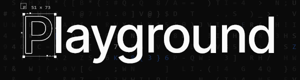
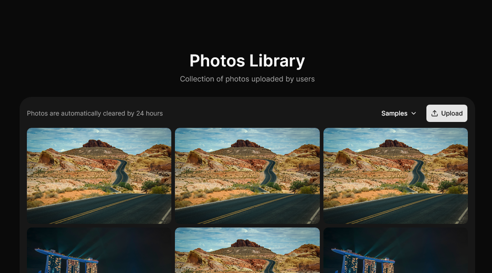
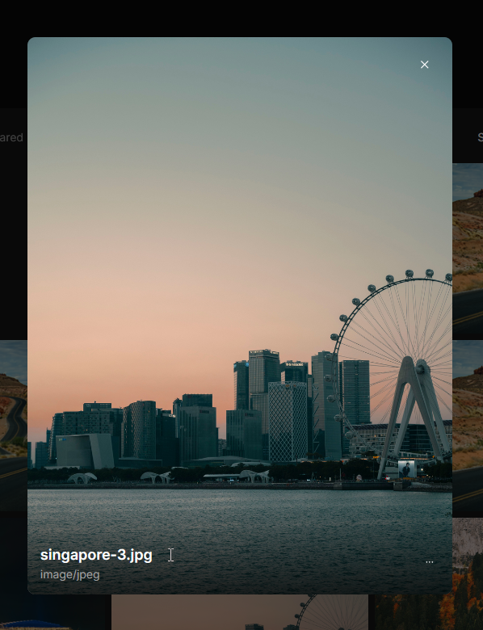
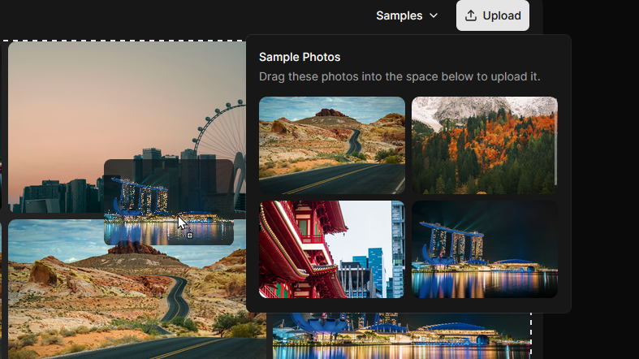
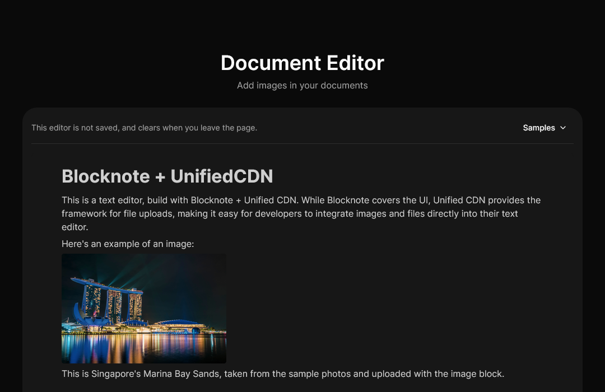
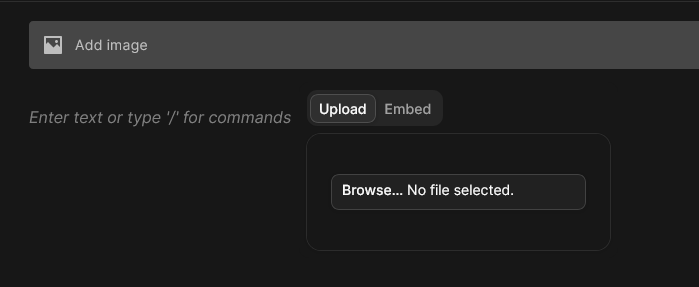
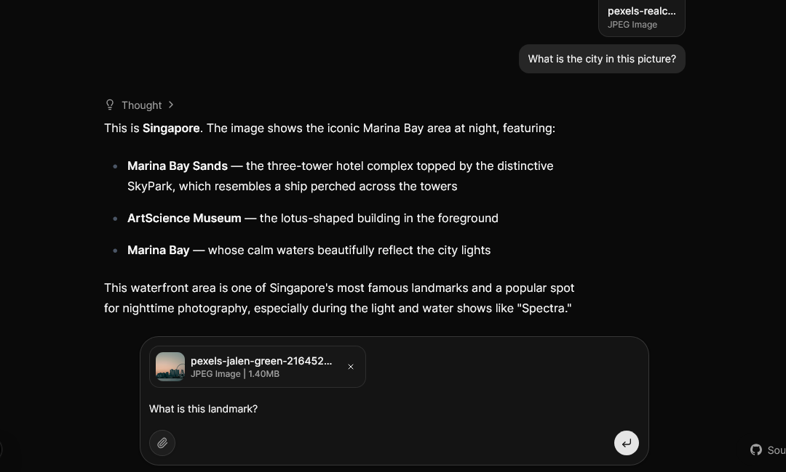
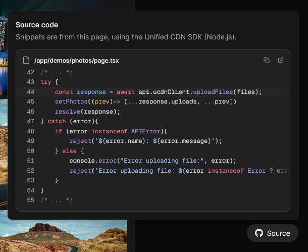
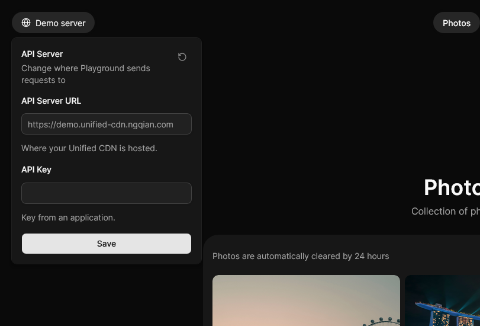

# Unified CDN Playground 🛝
**Playground** simulates real-world uses, letting you *explore* and *test* Unified CDN.

This project was made to showcase using Unified CDN in real apps, such as uploading and retrieving files. By default, Playground connects to the Demo instance, which you can learn more about [here](https://docs.unified-cdn.ngqian.com/dashboard/demo).

Additionally, this project was used to develop the [Unified CDN SDK](https://docs.unified-cdn.ngqian.com/sdk/node-js/Introduction), letting me test and make the SDK more reliable.

## Features
### Photo Library

The **Photo Library** shows how Unified CDN can upload and display photos. Each photo also expands on click, exposing the rename and delete functions.

|  |  Drawer with sample photos that can be dragged to test |
| --- | --- |
|   |   |

Feel free to use photo uploads as a gauge of your CDN's latency, but take note that the demo instance may feel slower due to the latency. (The demo API runs in Ohio and Singapore)

---
### Document Editor

**Document Editor** is built with [Blocknote](https://www.blocknotejs.org/), a popular react Notion-style editor.

Blocknote works in blocks, allowing you to reorganise headings, paragraphs, or images with drag. Blocknote also provides a function for file uploads into file blocks or image blocks, but developers often had to implement it themselves.

Unified CDN allows you to implement file/image upload with a **single line**, making it significantly easier to make your editors pop with colour :)

---
### AI Chat

**AI Chats** are becoming increasingly **multimodal**, with photos becoming extremely important for apps that integrate AI into their services.

The [AI SDK](https://ai-sdk.dev/) library is one of the most popular ways to build AI services into react applications, with hooks, API routes, and streaming out of the box.

Unified CDN provides **first-class support** for AI SDK, returning files with URLs that can be passed directly to the AI SDK, making it even easier for developers to integrate *images* and *documents* into their chats.

---
### Source popups

Every page provides a source popup, letting you see how Unified CDN was integrated into the page. 

In each popup, you can see a snippet of the code where Unified CDN was used, along with line numbers for reference. Clicking *Open in new tab* (top right button) brings you to the github page with the line reference, letting you view the full code of the page.

You can also use the line numbers to get a gauge of how much less code is needed to upload files now :p

---
### API Switcher
 

The **API Switcher** at the top left corner of the page allows you to change the API server and API key that Playground will use to load files.

If you created an application on the Demo dashboard, use the same API server url (https://demo.unified-cdn.ngqian.com), and key in your application's API key. This connects you to your application.

You can also use your own Unified CDN instance by replacing the API server URl with your Unified CDN URL (should contain no trailing paths or slashes, and must resolve to your dashboard).

## Acknowledgements
### Tech stack
- This project was created with **Next.js** and **Shadncn/UI components**.
- **Unified CDN** was used as the framework for manipulating files (duh)
- **Unified CDN SDK (Node.js)** was used to directly call the API from Server Actions or from the Client.
- React Bits was used for background and title animations on the landing page.
- Lucide icons and Simple icons were used for icons
### AI Usage
Github Copilot was used for autocompletion. No other AI was used in this project, and all components are handwritten.

## Run it yourself
If you want to deploy playground on your own infrastructure (for others to test or if u want to customise the UI), use the following steps.
1. Clone this repository
2. Install node packages with `npm i`
3. Rename .env.example to .env, and fill in the variables accordingly.
4. Run `npm run dev` into the terminal (navigate to the repo on ur terminal first) 
5. Visit http://localhost:3000. You should see the Playground in your browser.

If you want to deploy the playground on your server, just follow a Next.js deployment guide online, they'll probably explain it better than I can.